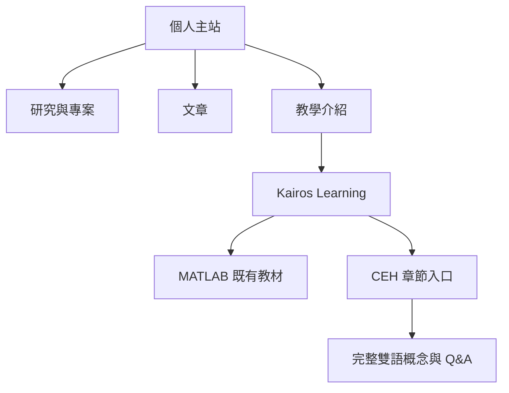

# cs-kairos.com 主站與教學站規劃

更新：2026-10-23（Asia/Taipei）。主站＋learn 與完整雙語為 adopted decision；
部署設計與下列實作階段為 implementation pending。詳細需求見[原始來源](sources/2026-10-23-kairos-site-requirements.md)。

## FIRST PRINCIPLE 與完成界線

- 稀缺資源：訪客注意力、Jason 的寫作／審稿時間、既有服務可用性與可信發布證據。
- Canonical home：本 repo 擁有個人站程式、網域遷移設計與主站驗證；[Kairos Learning](https://github.com/JasonLn0711/kairos-learning)擁有公開課程與教材。
- Planning role：[網站 locator](../../planning-everything-track/data/projects/2026-05-public-website-v3-clean-slate-rebuild.md#kairos-domain-plan-2026-10-23)與[日誌](../../planning-everything-track/weeks/2026-W43/days/2026-10-23.md#kairos-domain-plan-2026-10-23)保留狀態、容量、證據位置與下一關。
- Evidence path：[首頁驗證](site-v3-design-source.zh-tw.md)、本文件的現況查核、[公開教材規劃](https://github.com/JasonLn0711/kairos-learning/blob/main/docs/ceh-bilingual-publishing-plan.zh-tw.md)；Git 回執與公開網站驗收分開。
- Scope control：先完成主站靜態部署與一篇 M01 雙語教材；學習時數、實際回答、實作與正式準備度由 CEH repo 管理。
- Next gate：修正既有 Worker 的靜態資產部署設定，驗證預覽後再啟動網域綁定；CEH 首篇另需 Jason 確認內容。

## 已確認決策與目前實作

| 項目 | 狀態 | 說明 |
| --- | --- | --- |
| 主站＋learn 分工 | confirmed | 主站放個人、研究、專案與文章；learn 放 MATLAB、CEH 等課程 |
| CEH 完整中英文 | confirmed | 正文、例子、圖說、Q&A 與解析皆提供兩種語言 |
| 首頁閱讀優化 | published on GitHub Pages | 既有 Svelte 5＋SvelteKit 2＋adapter-static；人類閱讀與真實手機驗收待完成 |
| 接續既有 Worker | working assumption | 根據帳戶現有專案提出的部署方案，尚未修正或部署 |
| 新網域與 CEH 新頁 | implementation pending | 本次記錄規劃，不預填上線或文章完成 |

## Git 發布回執 — 2026-10-23

首頁實作 `a8084fd`、原始需求 `85256a9`、架構與設計文件 `4edb82c` 分開提交，
已以 `git push origin HEAD:main` 發布。重新 fetch 確認本機與 `origin/main`
同為 `4edb82c746efc79577edf4e268a74c124665cdf7`，divergence `0 0`；沒有衝突或歷史覆寫。

本機驗證：14 tests、Svelte check 零錯誤／零警告、adapter-static build 通過；
雙語響應式、24 個內部連結與無 JavaScript 閱讀檢查保留在[設計紀錄](site-v3-design-source.zh-tw.md)。
四個相關 repo 本輪新增內容的 87 個文件連結／錨點通過檢查。

[GitHub Pages run 39816130582](https://github.com/JasonLn0711/JasonLn0711.github.io/actions/runs/39816130582)
於 00:46（Asia/Taipei）完成成功；公開 `/` 與 `/zh-tw/` 回應 HTTP 200 且包含新版首頁
內容，RSS／sitemap 回應 HTTP 200 且 XML 可解析。新版已發布於既有 GitHub Pages 網址。
此回執後續文件提交不改網站程式或建置設定；
最新執行狀態以對應 commit 的 workflow 為準。Cloudflare Worker 修復、DNS／Custom Domain
與真人閱讀驗收仍待執行。[Planning 日誌](../../planning-everything-track/weeks/2026-W43/days/2026-10-23.md#kairos-git-publication-2026-10-23)
保留各 repo 的發布摘要與下一關。

## 2026-10-23 唯讀查核

Brave 中的 Cloudflare DNS 與 Worker 頁面已實際讀取。僅保留支援決策的
設定摘要；帳戶 ID、登入電子郵件、token、私有網址與完整日誌不納入本公開文件。

| 名稱 | 本次觀察 | 對規劃的意義 |
| --- | --- | --- |
| 根網域、www | DNS 頁與公開 DNS 查詢均未見可用網站記錄 | 待主站驗證後新增 |
| learn | CNAME 指向 jasonln0711.github.io，Proxied | 教學站保留 GitHub Pages；這是本次讀回，更新早期 DNS only 描述 |
| console、api | 既有 AI 平台 Tunnel，Proxied | 維持原用途；DNS 記錄不證明完整推論服務可用 |
| shanghui、shanghui-staging | 對應既有 production／staging Workers | 與主站分開管理 |
| jasonln0711-github-io Worker | 連到本 repo；latest build failed；No custom domains | 可接續現有專案，先處理部署再接域名 |

Worker 10/11 的部署日誌出現 `Missing file or directory: static/.assetsignore`。
日誌先辨識 `build`，之後進入 SvelteKit 自動設定並提出 `.svelte-kit/cloudflare`
路徑。現有 repo 使用 `public/` 與 adapter-static；明確指定 `build/` 靜態資產是
修正方向，成功與否仍須新的實際部署證據。

既有 MATLAB 案例二在 Brave 可閱讀；命令列 HTTPS 探測收到 403，不能以該次
探測判定教學網站故障。既有服務的端到端驗收與本次 DNS 盤點各自追蹤。

## 網域與資訊架構

| 網址／路徑 | 內容責任 |
| --- | --- |
| cs-kairos.com | 個人網站主入口 |
| www.cs-kairos.com | 永久轉址至根網域，保留路徑與查詢字串 |
| /research/ | 問題、方法、本人貢獻、成果狀態、論文與可公開證據 |
| /projects/ | 問題、角色、實作、測試、程式碼與展示 |
| /blog/ | 原創長文、研究筆記、方法與跨領域觀點 |
| /teaching/ | 教學方向、對象、目標與 learn 課程入口 |
| /about/ | 個人簡介、經歷、CV 與公開聯絡方式 |
| learn.cs-kairos.com | 課程導覽、概念文章、例子、Q&A 與教材下載 |

主站保留現有 `/zh-tw/`、文章 slug 與歷史相容路徑。CEH 全文以 learn 為主要
網址，主站以獨立觀點文章或課程介紹連入，避免兩站維護相同全文。

首頁沿用[既有閱讀設計](site-v3-design-source.zh-tw.md)：簡介與照片、精選文章、
最新文章、主題入口、研究與實作。主參考為 [swyx](https://swyx.io/)，文章分類與
掃讀參考 [Julia Evans](https://jvns.ca/)。暖白底、深色文字與少量強調色跨站一致；
技術文章優先處理行寬、目錄、表格與程式碼溢出、鍵盤操作及語言切換。

## 部署方案與遷移順序

1. 在本 repo 明確設定 Workers Static Assets 使用 `build/`；保留 adapter-static，
   鎖定已驗證工具版本，避免部署時再次自動改寫框架設定。
2. 跑現有測試、型別檢查與建置，以 Worker 預覽核對首頁、深層文章、靜態資產、
   404 與語言切換。未知網址不得以首頁成功回應掩蓋錯誤。
3. 將主站 metadata 基準改為 `https://cs-kairos.com`，同步 canonical、Open Graph、
   RSS、sitemap、robots.txt 與 hreflang；檢查所有已存在網址的銜接。
4. 驗證後，以既有 Worker 的 Custom Domain 綁定根網域，再設定 www 的 DNS 與
   永久轉址，核對 HTTPS、路徑與查詢字串。現有五筆服務記錄保留原用途。
5. GitHub 舊網址先保留可讀並使用新 canonical；舊站轉址由 GitHub 端另行處理，
   Cloudflare 不擁有 github.io 的 HTTP 回應。不要把兩個來源的轉址能力混為一談。
6. 每次發布保存 commit、建置產物、執行回執、公開 URL 與檢查日期；保留上一個
   可用版本與變更前設定，以便回復。Git 推送、CI、服務可讀與人類驗收分開記錄。

主站先接續既有 Worker；learn 維持現有 GitHub Pages。後者將來加入 SvelteKit
產生器時，保留 MATLAB 的完整相對路徑、`.html`、錨點與版本化下載。
改用新建置目錄前，既有教材檢查和下載 SHA-256 檢查必須繼續通過。

目前主站 GitHub Actions 仍在 push main 後發布 GitHub Pages；Cloudflare 亦已連到
該 repo。單純推送本次文件與首頁提交可能觸發既有流程，與修正 Worker 或啟用
cs-kairos.com 是不同操作。以每次 CI 回執記錄實際結果，不能因 Git 成功就標示網域上線。

## CEH 與雙語內容的連接

[Kairos Learning 的課程規劃](https://github.com/JasonLn0711/kairos-learning/blob/main/docs/ceh-bilingual-publishing-plan.zh-tw.md)
擁有 M01–M20 編輯地圖、首篇候選、雙語 URL、metadata、Q&A 與驗收規格。
CEH repo 的[公開教材橋接](../../ceh-cehp-certification-notes-2026/docs/public-teaching-bridge-2026-10-23.md)
擁有公開教材與個人閱讀／正式練習的分界。

CEH 系列採一篇一個完整概念；正式日常閱讀沿用 10/22 的一例、一個小檢核。
公開 Q&A 使用獨立 ID，資料準備與發布不寫成 Jason 已答題、已理解或通過實作。
主站原有[每日 Blog 格式](learning-publishing.md)保留其適用科目與單一 URL 雙語格式；
新的 CEH 課程採兩個語言 URL，不因此重寫所有既有文章。

## 階段、所有權與容量

| 階段 | 擁有者／交付 | 最小完成檢查 |
| --- | --- | --- |
| 主站部署準備 | 本 repo：靜態資產設定、metadata、網址清單 | tests、check、build、Worker 預覽 |
| 正式網域 | 本 repo：Custom Domain、www、HTTPS | 根網域與深層頁可讀、XML、404、既有服務保持可用 |
| CEH 範本 | Kairos Learning：課程入口、M01、一篇雙語文章與 Q&A | Jason 審閱、語言對應、來源、靜態閱讀、MATLAB 回歸 |
| 持續擴充 | Kairos Learning：逐篇完整內容 | 每篇公開 URL 與更新證據 |

寫作／審稿沿用已確認容量；每週 CEH＋CEHP 共用 240 分鐘、課日自學最多
25 分鐘。當週實際可用量仍待確認，不把上限當作可排空檔。M01 公開編輯不重設
M04 個人閱讀位置；600 題與 11/29 目標維持待重估。沒有新增固定日／週篇數。

會員、成績追蹤、留言、AI 助教、站內搜尋與大型影片託管列 deferred activation；
出現明確需求且容量允許時再評估。研究群島仍屬原探索方向，本輪不啟動。

## 官方查核與後續紀錄

以下於 2026-10-23 查閱；執行部署時再核對版本與介面：

- [SvelteKit 靜態產生](https://svelte.dev/docs/kit/adapter-static)：本 repo 保留 SvelteKit 2 設定格式，不直接套用較新主版本範例。
- [Cloudflare 平台方向](https://developers.cloudflare.com/pages/)與[Static Assets](https://developers.cloudflare.com/workers/static-assets/)：新平台方向與靜態託管能力。
- [Worker Custom Domains](https://developers.cloudflare.com/workers/configuration/routing/custom-domains/)：根網域綁定與 www 轉址的設定責任。
- [GitHub Pages 自訂網域](https://docs.github.com/en/pages/configuring-a-custom-domain-for-your-github-pages-site/managing-a-custom-domain-for-your-github-pages-site)：既有教學站來源與網域設定。
- [Google 多語頁面](https://developers.google.com/search/docs/specialty/international/localized-versions)：語言對應與 sitemap。
- [網域資產 locator](../../planning-everything-track/data/projects/2026-10-cloudflare-domain-gx10-platform.md#kairos-domain-plan-2026-10-23)：既有註冊與平台歷史接續本次盤點。
