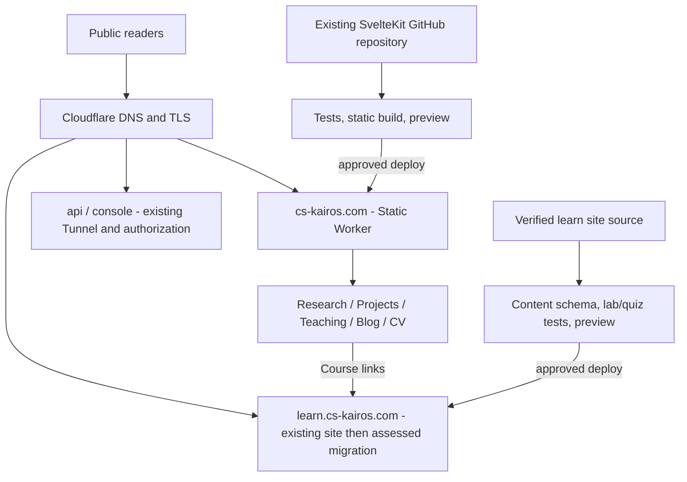

# CS Kairos 平台架構與遷移藍圖 v1.0

> 採用更新：2026-10-23，依本人完整 Phase 0–3 實作與發布要求採用。以下提案時點的盤點保留沿革；現行狀態、細化決議與驗收以 [實作回執](phase-0-3-implementation.zh-tw.md)及 [learn 內容規範](https://github.com/JasonLn0711/kairos-learning/blob/main/docs/content-authoring.md)為準。本人授權、代理技術審閱與獨立讀者接受分別記錄。

> 狀態：Adopted；本人已要求完整實作與發布，工程與上線證據見實作回執。獨立讀者接受另行驗收。
> 日期：2026-10-23（Asia/Taipei）
> 適用：`cs-kairos.com` 主網站、`learn.cs-kairos.com` 公開課程入口
> 既有規範：`AGENTS.md`、`docs/site-v3-design-source.zh-tw.md`、`docs/learning-publishing.md`。本文件是補充，不得默默覆寫既有規範。

## 1. 第一原理與範圍

**目的**：長期保存並傳達經過證據查核的研究、工程實作與教學成果；讀者能辨別「已驗證的結果、原型、想法、限制」並找到下一步。

設計決策依序最佳化：可信度與安全 > 內容正確/可維護 > 可理解/可找到 > 效能 > 動畫和裝飾。

此階段不包含：重新設計品牌、登入/付費會員系統、LMS 成績後端、替換 AI 推論平台、把研究內部筆記全數公開、強迫發布頻率。

## 2. 已核查環境（2026-10-23，需於執行前重查）

- 主網站源碼：`JasonLn0711/JasonLn0711.github.io`；SvelteKit + TypeScript + mdsvex + `@sveltejs/adapter-static`；預渲染輸出 `build/`。
- 既有品牌／設計標準：Living Research Atlas v3.0；主頁資料 `src/lib/content/site.ts`；共用元件／樣式沿用。
- `site.url` 目前設定 `https://jasonln0711.github.io`；**自訂網域正式切換後**才改 canonical、OG URL、sitemap、RSS 等基準地址。
- Cloudflare DNS 面板顯示 `@` 與 `www` 尚無網站 DNS；`learn` 是 proxied CNAME 指向 `jasonln0711.github.io`；`api`、`console` 是既有 Tunnel；`shanghui` 及其 staging 是 Worker。
- Cloudflare 帳戶亦顯示 `jasonln0711-github-io` Worker；需先檢查其實際部署內容、Git 來源、build command 與 custom-domain 佔用，再決定是否重用。
- `https://learn.cs-kairos.com/courses/matlab-practice/index.html` 目前有 MATLAB 教材、測試說明和 ZIP 資源。**不得在不知道其源碼與部署路徑之前覆蓋**。
- 以上是當時的只讀檢查，不代表任何 DNS、部署或程式碼已經修改。

## 3. 網域與責任邊界（決策）

| 網域／路徑 | 公開程度 | 責任與內容 | 本期決策 |
| --- | --- | --- | --- |
| `https://cs-kairos.com/` | 公開 | 個人研究與工程入口 | 使用現有 SvelteKit，部署於 Workers Static Assets |
| `/research/`、`/projects/`、`/teaching/`、`/blog/`、`/about/`、`/resume/` | 公開 | 沿用現有 routes 和內容資料來源 | 不為此另開子網域 |
| `https://www.cs-kairos.com/*` | 公開 | `cs-kairos.com` 的別名 | 確保 TLS 後，單次 301/308 保留路徑及 query 轉址 |
| `https://learn.cs-kairos.com/` | 公開 | 可互動、可下載的學習教材 | 原位保護既有 MATLAB 路徑，先增設 CEH 課程 |
| `/courses/matlab-practice/*` | 公開 | 既有課程、下載與超連結 | 完全保留相容性 |
| `/courses/ceh/` | 公開 | CEH 系列課程入口及版本導覽 | 指向當前支援版，非永久重導至特定版本 |
| `/courses/ceh/v13/*` | 公開 | 對應 CEH v13 的原創教材與題庫 | 建立穩定版本 URL；更新版新增並行路徑 |
| `api.cs-kairos.com` | 限定授權 | 既有 GX10 API | 不在此次變更範圍；驗證認證、CORS、速率限制 |
| `console.cs-kairos.com` | 限定授權 | 既有 GX10 管理介面 | 不在此次變更範圍；驗證 Cloudflare Access 政策 |
| `shanghui*.cs-kairos.com` | 既有獨立應用 | 其他 Worker 應用 | 不修改路由、網域或設定 |

**禁止**：在公開靜態教材中嵌入管理 API 憑證；把 `api` 或 `console` 當成公開教學 API；跨網域共用萬用 cookie；不經盤點就將 `learn` 指向新的 origin。

## 4. 平台決策紀錄（ADR-001）

### 建議：主站採 Cloudflare Workers Static Assets；學習站分階段處理

現有主站已使用 `adapter-static` 且可以產生 `build/`，本期保留。部署器只負責把建置產物交給 Workers Static Assets；**不為了託管更換 SvelteKit adapter 或改成 SSR**。如既有 `jasonln0711-github-io` Worker 符合需求，優先重用該部署管線而不是再建立重複服務。

Cloudflare 於 2026-08 表示 Workers 是新專案的主要應用平台，適用靜態資源與 Git 整合；Pages 仍可用，但不作為本次主站的新預設。使用者目前的 `learn` 已經運作，**不必為一致性立即遷移**。

| 選項 | 好處 | 代價/風險 | 決策 |
| --- | --- | --- | --- |
| GitHub Pages（維持所有站） | 遷移量少 | 主站尚缺自訂網域入口；獨立的 Cloudflare 部署能力未發揮 | 作為舊路徑與回退參照 |
| Cloudflare Pages | Git 連接與 PR Preview 成熟 | 對現有 Worker 可能產生雙管線；新專案非官方優先方向 | 非首選 |
| **Workers Static Assets** | 可重用既有 Worker、Git Builds、Custom Domain；靜態內容不需後端 | 需盤點 Wrangler/build 設定與正式路由 | **主站首選** |

參考：<https://developers.cloudflare.com/workers/static-assets/>、<https://developers.cloudflare.com/workers/ci-cd/builds/>、<https://developers.cloudflare.com/workers/configuration/routing/custom-domains/>。

## 5. 架構視圖

主站和學習站需要共同的品牌、導覽、來源標註、視覺 Token 和連結設計；但保有各自的版本、建置、部署與回滾。是否合併 monorepo 必須經過維運成本與依賴關係評估，不以合併本身為目標。

## 6. 資訊架構與使用者旅程

主站首頁：身份與研究主張 → 精選閱讀（curated）→ 最近五篇已發布文章（從正式 metadata 取得，不是硬編碼）→ 研究證據 → 系統作品 → 教學入口 → Contact/CV。以既有 Codex 正在實作的共同雙語首頁為基線，避免平行改首頁程式。

- Research：每項研究必須提供問題、假說/方法、資料界線、評估、結果成熟度、限制、論文/程式碼/證據連結。
- Projects：問題、架構、實際完成的功能、技術棧、demo/測試、哪些尚未完成、安全與資料界線。
- Teaching：開課對象、前置知識、成果、課程地圖與正式進入 `learn` 的連結。
- Blog：保留既有單一網址的雙語 daily-learning 合約，不偽造學習證據。
- About/CV：以可核實學經歷為主，避免把尚未公開的研究或原型寫成完成的產品。

學習站首頁：**Start here / Courses / Learning paths / Glossary / Search / About content standards**。課程路徑：課程介紹 → 模組地圖 → 先備概念 → 單元 → 知識檢查 → 本機安全練習 → 章末情境題 → 延伸資料。

導航需支援行動裝置、鍵盤、跳到內容、適當語系與降低動態效果。視覺延用 v3.0 主站 Token，但學習頁面以較高閱讀對比、清晰程式碼和更低動畫密度為原則。

## 7. 內容來源與儲存庫

- 現有主站 repo 是主站**唯一內容發布權威**。保留 `src/lib/content/site.ts`、`src/content/blog/`、`docs/learning-publishing.md` 的契約。
- **先定位** `learn` 現有的 GitHub 專案、Pages 設定與靜態教材來源，再決定延續該 repo、設立獨立 learn repo、或用受控子目錄。來源不明時不得建立同名路徑覆蓋正式站。
- CEH 教材推薦的來源路徑（位於最後選定的 learn source repo）：`content/courses/ceh/v13/modules/m01/*.mdx`、`quizzes/*.yaml`、`references.yaml`、`schemas/course.schema.json`、`public/labs/`。
- 訓練範例、合成資料、可重現腳本需與實際研究原始資料隔離；公開下載包含 SHA-256 checksum、版本、授權與可運行環境。
- 通用內容由 Markdown/MDX + schema + Git 審查發布；後台 CMS、登入、成績資料庫待需求證明才導入。

## 8. 部署順序與回滾門檻（不得跳步）

1. **Inventory**：匯出 DNS/Worker/Custom Domains/Build 設定快照；找到 `learn` 真正 source；列出全部既有路徑、課程下載、API/console 保護狀態；確定主要網址 canonical 策略。
2. **Local/Preview**：在獨立分支完成部署設定，執行 `npm ci`、`npm test`、`npm run check`、`npm run build`，由 Preview 手機/桌機驗證。只在通過後動手 DNS。
3. **Main cutover**：將既有或新 Static Worker 綁 `cs-kairos.com` **Custom Domain**（Cloudflare 自動配置所需 DNS/TLS）；驗證 HTTPS、首頁/文章/404/CSP。再配置 `www` DNS/TLS 與單次轉址。
4. **Canonical cutover**：確認已上線後改 `site.url`、Open Graph、canonical、RSS、sitemap、internal links。舊 GitHub Pages 入口應有可行的轉址或明確 canonical，不允許永久重複索引。
5. **Learn expand**：保持 `learn` 原 CNAME 不變，在原本發布管線推出 CEH 試點；逐頁驗證 MATLAB 的 HTML、下載、書籤及外部連結。
6. **Potential learn migration**：若測試證明有價值，另建 Preview、比對所有 URL 與下載 SHA-256、核對 redirect map，才允許切換 CNAME/Custom Domain；至少保留舊版建置與 DNS/路由復原資訊。
7. **Operations**：監測部署失敗、404、異常流量、依賴安全與外部來源失效；每次正式修改保留 commit、部署 ID、變更摘要與回滾責任人。

如單一驗收失敗：**先回復該站至上一個有效版本與路由**，不可透過修改 `api`、`console` 或關閉 Access 解決公開站部署問題。

## 9. 驗收規則

- 主站主網域可用、HTTPS 無證書錯誤、www 單次轉址、`site.url` 與 sitemap/canonical 一致、所有公開導航可達且 404 回傳真正 404。
- `learn` 原 MATLAB 教材與 ZIP 路徑可開啟、下載檔 checksum 對得上切換前基準。
- 手機寬度 320px、390px 與桌機 1280px 適當呈現，鍵盤可導航，文字對比與互動符合 WCAG 2.2 AA 的適用檢查項目。
- 重要頁面目標：Lighthouse Accessibility/Best Practices/SEO ≥ 90（實驗室指標，不能取代真人測試）；網頁體驗依實際收集 Core Web Vitals 監測，LCP ≤ 2.5 秒、INP ≤ 200ms、CLS ≤ 0.1（p75 目標）。
- 不得洩露 token、憑證、私人逐字稿、受試者/病患資料、未公開專利細節。
- 所有宣稱「發布完成」都必須有 live URL、部署證據與驗收結果，不得把 PR、設計稿或 build success 等同於正式上線。

## 10. 下一個最小可用版本（MVP）

必做：主網域上線；沿用現有首頁；跨站導覽一致；`learn` 既有 MATLAB 不受損；CEH 課程索引 + M01 試點教學 + 自製 Q&A；發布與安全規範自動檢查。

暫不做：帳號、付費、複雜 LMS、AI 自動批改學習成果、個人化模型路由、GraphQL 後端、全部 20 章同步開工。優先證明**讀者真的能學會並完成一個小練習**，再擴充。

## 11. 正式引用與追蹤

- Workers 靜態資源：<https://developers.cloudflare.com/workers/static-assets/>
- Workers Git Builds：<https://developers.cloudflare.com/workers/ci-cd/builds/>
- Workers Custom Domains：<https://developers.cloudflare.com/workers/configuration/routing/custom-domains/>
- SvelteKit Workers：<https://developers.cloudflare.com/workers/framework-guides/web-apps/sveltekit/>
- 既有主站政策：`AGENTS.md`、`docs/learning-publishing.md`、`docs/site-v3-design-source.zh-tw.md`
- 學習內容規格：`docs/ceh-course-content-standard-v1.zh-tw.md`
- 發布與保護：`docs/cs-kairos-publishing-security-standard-v1.zh-tw.md`

**變更條件**：僅當 source inventory 與 preview 測試顯示現有部署管線不符合需求，才另開 ADR 討論合併儲存庫、更換框架或新架構。
