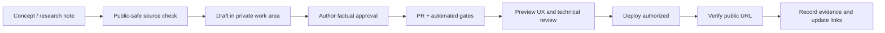

# CS Kairos 發布、審核、資安與維運標準 v1.0

> 採用更新：2026-10-23，依本人完整 Phase 0–3 實作與發布要求採用。以下提案時點的盤點保留沿革；現行狀態、細化決議與驗收以 [實作回執](phase-0-3-implementation.zh-tw.md)及 [learn 內容規範](https://github.com/JasonLn0711/kairos-learning/blob/main/docs/content-authoring.md)為準。本人授權、代理技術審閱與獨立讀者接受分別記錄。

> 提案草稿；2026-10-23。不得凌駕原有 `AGENTS.md`、`docs/learning-publishing.md`、`docs/site-v3-design-source.zh-tw.md`。遇到衝突應提出 ADR/PR 決議。

## 一、治理原則

1. **證據先於敘事**：所有研究、產品、經歷與實驗宣稱要區分「可查核事實、來源說法、作者推論、尚未驗證」；不因排版而變成成就宣稱。
2. **單一權威來源**：主站公開資訊由既有 `site.ts` 或其正式資料契約管理；文章由既有 `src/content/blog` 管理；課程由最後確認的 learn source repo 管理。規範不得創建競爭性內容入口。
3. **明確責任**：AI/Codex 可起草、執行測試、建立 PR；研究作者負責確認事實、內容、權利與正式發布。**未經確認不自動發布教材或增加履歷成果**。
4. **可回滾**：每次更新有版本、PR、成功 CI、部署 ID、URL 與回復途徑。
5. **安全界線**：公開網站只放公開安全內容，私人文件、受試者資料、金鑰與公司內部資訊不進公共 repo。
6. **改善真正影響學習的環節**：先讓知識正確、教學有效、連結穩定，再做複雜動畫或自動化。

## 二、分類與檢查
| 分類 | 例子 | 處理 |
| --- | --- | --- |
| Public | 原創理論文章、授權圖像、合成範例、公開論文摘要 | PR 核對來源與授權後發布 |
| Review required | 尚未公開的研究結果、論文實驗、商業技術提案、合作成果 | 須先確認權利、公開範圍及資料去識別 |
| Restricted | 實驗室內部會議、原始逐字稿、弱點回報細節、基礎設施設定 | 不進 public repo；存受保護內部系統 |
| Prohibited | 金鑰、token、病患可識別資料、密碼、未授權他人資料 | 不得提交、部署或載入瀏覽器端 bundle |

設 `PUBLIC_RELEASE_CHECKLIST.md` 或 PR template：內容作者、來源 URL/日期、原創性、授權、外部連結、資料分類、研究成熟度、實驗可重現、SEO/無障礙、QA、部署驗證。

## 三、可機器化品質門檻
**每個主站 PR**：
- `npm ci`、`npm test`、`npm run check`、`npm run build`。
- Markdown/frontmatter/schema 合法；所有內部連結可解析；外部連結失效提供警告/人工審核（避免把暫時網路故障造成阻擋）。
- Site identity、homepage 最近文章、RSS/sitemap/canonical 與 robots 維持一致，draft/future content 不可漏出。
- 無 secret、無敏感資料、依賴與授權檢查；CSP 與防止 XSS 須經實際測試，不能以一個 WAF 或 HTTP header 當成程式碼安全證明。
- 主站設計遵循 Living Research Atlas v3，不無故大規模改動既有元件。
- 在手機與桌面進行人工 Preview 評估（實際工具/螢幕尺寸記錄）。

**每個 learn 教材 PR**：除前述通用門檻外，核對 CEH 版本、每個 lesson objective 及對應練習、Q&A 正解與所有干擾選項解析、lab 合法性、無失效的下載資源及 checksum、既有 MATLAB 路徑回歸測試。

**可觀測指標**：
- 發布完整性：正式成功部署 / 正式嘗試、404/死連結、遭撤回的事實錯誤。
- 學習成效：自願匿名試讀者能完成概念題與動手操作的比例（如未取得資料，不假裝有成效數據）。
- 網站健康：Core Web Vitals p75、可用性、Build failure rate、停機及回復時間。
- 指標不應變成催促每日發布的硬 KPI；品質不夠時允許保留草稿。

## 四、資安部署基準
1. GitHub 使用 MFA / passkeys；限制生產部署權限，branch protection + 必要 CI + 審查，憑證最小權限、短效 token、定期檢查 secret 清單。任何疑似洩漏都視為需輪替憑證；刪除 commit 本身不足以解除風險。
2. Cloudflare Git-integrated Worker/Pages 使用最小部署 token；避免把 API token 寫入 `wrangler.toml`、`public/`、browser JS、repo secrets 以外檔案。
3. 公開靜態站 HTTPS、合理 CSP、Referrer-Policy、X-Content-Type-Options、HSTS（僅在子網域都支援 HTTPS 且測試後逐步啟用）；適當 cache-control：版本化 assets 長快取，HTML 短快取以支援修正。
4. `console` 與 `api` 的 Zero Trust/服務認證獨立維護，不隨公開主站切換而放寬規則；允許的跨來源（CORS）採白名單，認證與授權仍由後端強制執行。
5. 不將 `learn` 本機學習進度上傳伺服器；若未來加帳戶，另行做資料最小化、保留期限、刪除程序、隱私政策及威脅模型。
6. CEH lab 避免外網攻擊教學；以自建環境、合成日誌、唯讀分析與防禦情境為主。任何提供的可執行範例都經隔離環境檢查。

## 五、文章出版工作流

- 既有 daily-learning 文章遵循 `docs/learning-publishing.md`：先由作者說明真實理解、編輯成中英文、作者確認，再發布；**不可把 ChatGPT 產出的教學文字當成使用者已學會的證據**。
- 非 daily-learning 的 CEH lesson 使用獨立課程審核流程，但任何聲稱考過、實測過、驗證過的結果仍須有實際證據。
- 正式文章的 `pubDate` 是台北時間實際首次發布日，`updatedDate` 不應冒充首次發布；內容明顯過時應標 `review-needed` 或撤銷指引，而不是靜默改掉原版。
- 中文預設 `zh-Hant-TW`，英語教材若未完成有品質的翻譯就標單語，不得用不可靠機器翻譯假裝雙語完成。

## 六、無障礙/設計規格
- 適用 WCAG 2.2 AA：鍵盤焦點、語意 heading 層級、表單 label、錯誤回饋、字級縮放、合理行距、可讀對比、reduced motion。
- 切換語言或題目不應造成焦點消失；答案揭露對螢幕閱讀器可感知；不能只有顏色區分正確/錯誤。
- 程式碼行不要強迫斷行破壞語法，手機採可水平捲動程式區塊；圖片和影片提供 alt、字幕/逐字稿。
- 課程站的遊戲化不能犧牲可閱讀性；避免閃爍、長動畫、無端自動播放。

## 七、SEO 和路徑政策
- 正式頁一律唯一 canonical、標題和 description；重定向應保留既有外部書籤，慎防軟 404。
- Article/TechArticle/Person/BreadcrumbList 等結構化資料僅在頁面內容與 schema 符合時使用；不寫虛假的評論分數或學習成效。
- 開放的課程內容可搜尋，草稿、管理端、登入保護服務不列入 sitemap。robots.txt 不是資料隱藏或存取控制。
- 圖像用可靠授權與壓縮輸出、設定尺寸避免 CLS；避免以 SEO 為由公開敏感資料。

## 八、事故與回滾
| 事件 | 第一動作 | 回復條件 |
| --- | --- | --- |
| DNS/自訂網域故障 | 回復先前可用的 route/Worker/domain 設定；核對 TLS | 原網站路徑與 HTTPS 可讀 |
| 新版部署損壞 | 回滾到上一個成功 deployment | 核心路徑/下載 smoke test 通過 |
| 教材重大錯誤 | 暫撤危險步驟、標註更正並保留修訂記錄 | 經技術審查後重新公開 |
| 憑證洩漏 | 立即撤銷輪替、檢查日誌與受影響服務 | 不依賴「刪掉 Git commit」作為解決 |
| 外部連結/教材壞掉 | 建立 issue 與已知故障提示 | 驗證目標與下載 checksum |

**責任分離**：Codex 可準備修正 PR 與驗證報告；正式 DNS、worker routes、Access policy、main merge 與 public release 應依既有權限與明確授權決定。不得一邊編輯邊臆測現有環境。

## 九、四階段交付
**Phase 0（盤點）**：查清所有 host 的 source/deployment/DNS 及風險，保存可回滾快照。
**Phase 1（可公開主站）**：不變更框架，主網域 Cloudflare Static Worker 上線與 SEO 校正。
**Phase 2（CEH Pilot）**：在現有 learn source 新增課程索引、M01 兩篇與原創 Q&A，驗證 MATLAB 不受影響。
**Phase 3（擴充）**：M02–M05、跨模組字典、錯題複習、站內搜尋及合理的內容品質統計；滿足能力門檻後依序擴展至 M20。

每階段有 **Demo URL、CI 結果、內容審閱、回歸清單、commit、回滾指令**，缺一不得宣稱「已交付」。
